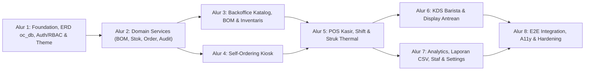
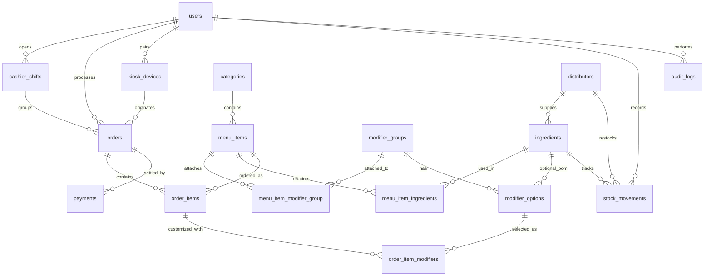

# Implementation Roadmap & Plan — Our Coffee

Dokumen ini merangkum **Roadmap Implementasi lengkap (Alur 1 – Alur 8)** untuk membangun **Our Coffee** (Self-Ordering Kiosk, POS Kasir, Kitchen Display System, dan Backoffice Admin) di atas stack **Laravel 13 + Inertia.js v3 + React 19 + TypeScript + Tailwind CSS v4 + `shadcn/ui`** dengan database tunggal **`oc_db`** (MariaDB 13.0.2), serta rancangan teknis rinci untuk **Alur 1**.

---

## Master Implementation Roadmap (Alur 1 – Alur 8)

### Checklist Status Roadmap

- [x] **Alur 1 — Fondasi Sistem, Skema Database (`oc_db`), Models, Auth/RBAC & Design Tokens** _(SELESAI — Terverifikasi 2026-11-23)_
    - Konfigurasi `Asia/Jakarta`, locale `id`, helper format integer Rupiah (`id-ID`) PHP & TS, serta `phpunit.xml` -> `oc_db_testing`.
    - Seluruh migration `oc_db` (18 tabel domain + penyesuaian `users`), 11 PHP Backed Enums, Eloquent Models & relasi, Factories, dan `DatabaseSeeder` realistis (akun Admin/Kasir/Barista + PIN 6 digit, perangkat Kiosk default, kategori, menu kopi & non-kopi, modifier groups/options, distributor, bahan baku, resep BOM, stok awal, app settings).
    - Middleware RBAC (`role`), `kiosk.device`, `shift.open`, penghapusan kewajiban `verified`, redirect login berbasis role (`/admin/dashboard`, `/pos/shift` atau `/pos`, `/kds`), dan shared Inertia props (`auth.user.role`, `activeShift`).
    - Design System tokens _Espresso_ (`#1c120d`), _Crema_ (`#b45309`), _Oat_ (`#faf7f2`), _Latte_ (`#eadfd3`), font `Plus Jakarta Sans` & `JetBrains Mono` (`tabular-nums`), dan komponen shell dasar **Left Navbar / Rail** (`OurCoffeeRailLayout`).

- [x] **Alur 2 — Core Domain Engine (BOM Costing, Auto Sold-Out, Atomic Stock Deduction, Order & Audit)** _(SELESAI — Terverifikasi 2026-11-23)_
    - `BomCostService`: kalkulasi HPP & Gross Margin (%) per menu dari resep `menu_item_ingredients`.
    - `MenuAvailabilityService`: evaluasi ketersediaan menu real-time dari toggle manual `is_available` dan kecukupan stok bahan baku BOM (`current_stock >= recipe.quantity`).
    - `InventoryService`: pemotongan stok atomik dalam `DB::transaction()` + `lockForUpdate()` saat transaksi lunas (`sale`), pencatatan `restock` (Stock In + update `cost_per_unit`), `waste`, dan `opname`.
    - `OrderService` & `QueueNumberGenerator`: pembuatan order Kiosk/POS, deteksi konflik stok habis (HTTP `409 Conflict` dengan daftar item habis), nomor antrean harian (`#A-001` reset pukul 00:00 `Asia/Jakarta`), dan transisi status order tervalidasi.
    - `QrisGatewayInterface` + `SimulatedQrisGateway`: buat transaksi QRIS dinamis, cek status, expiry, dan simulasi pembayaran lunas.
    - `PinAuthorizationService` & `AuditLogService`: verifikasi PIN 6-digit Supervisor/Admin + pencatatan immutable `audit_logs`.

- [x] **Alur 3 — Backoffice Admin: Katalog, Modifier, Resep (BOM) & Inventaris (`/admin/*`)** _(SELESAI — Terverifikasi 2026-11-23)_
    - Navigasi Left Rail Admin lengkap untuk seluruh rute `/admin/*`.
    - CRUD Kategori (`sort_order`, ikon Left Rail, status aktif) & CRUD Menu (upload gambar `storage/public`, rasio `4:3`, badge `Best Seller`/`New`, toggle manual _Sold Out_).
    - CRUD Grup Modifier (`single`/`multiple`, wajib/opsional, `min_select`/`max_select`) & Opsi Modifier (`price_delta`, `is_default`, tautan opsional ke bahan baku).
    - **Editor Resep (BOM)** per menu dengan pratinjau langsung **HPP** dan **Gross Margin (%)**.
    - Master Bahan Baku (`StockLevelBar`, batas minimum, unit `g`/`ml`/`pcs`), Master Distributor, formulir **Stock In** (menambah stok, memperbarui harga beli terakhir, dan otomatis memulihkan menu _Sold Out_), pencatatan _Waste_, _Stock Opname_ (tercatat ke Audit Log), dan riwayat `stock_movements`.

- [x] **Alur 4 — Self-Ordering Kiosk (`/kiosk`)** _(SELESAI — Terverifikasi 2026-11-23)_
    - Flow _device pairing_ token -> cookie perangkat terverifikasi middleware `kiosk.device`; blokir total akses ke seluruh rute staf.
    - **Welcome Screen** dengan branding _Our Coffee_ & tombol besar **"Mulai Pesan"** (pemicu _fullscreen_ API).
    - Pilihan **OrderType** (_Dine-In_ / _Takeaway_) + nama panggilan opsional.
    - Katalog Menu dengan **Left Category Rail** vertikal, tanpa _horizontal scroll_, target sentuh minimal `64×64 px`, kartu `4:3`, indikator otomatis **HABIS** (_disabled_) dengan polling ketersediaan **5 detik** (auto-pause saat tab tidak aktif).
    - `ModifierSheet` kustomisasi wajib/opsional dengan kalkulasi harga _live_, keranjang lokal via **Zustand**, serta dialog penanganan konflik HTTP `409 Conflict` saat checkout.
    - Pembayaran **QRIS Dinamis** (polling status **2 detik**, countdown timer, regenerate QR, atau fallback ke **Bayar di Kasir** tanpa mengulang keranjang) & **Bayar di Kasir**.
    - Layar **Konfirmasi** nomor antrean besar (mis. `#A-014`) + auto-reset ke Welcome Screen setelah **8 detik**.
    - Keamanan Kiosk: _idle timeout_ **60 detik** (modal peringatan di detik ke-50), kunci _zoom_ & klik kanan, serta gestur tersembunyi (_long-press_ logo 3 detik / 5× ketuk) + **PIN Admin 6 digit** untuk keluar ke Backoffice.

- [x] **Alur 5 — POS Kasir, Manajemen Shift & Cetak Struk Thermal (`/pos`, `/pos/shift`)** _(SELESAI — Terverifikasi 2026-11-23)_
    - Layar Buka Shift (`/pos/shift`) wajib sebelum mengakses `/pos` (middleware `shift.open`) dengan input modal awal laci kas.
    - Layout **3 Kolom penuh tanpa outer scroll**, target sentuh minimal `48×48 px` (`60×60 px` untuk `NumPad`):
        1. **Kolom 1:** Antrean _Pending Kiosk_ (polling **3 detik**) & daftar tiket aktif.
        2. **Kolom 2:** Grid menu _walk-in_ + filter kategori + `ModifierSheet` cepat.
        3. **Kolom 3:** Ringkasan tagihan, metode bayar **Tunai** (`NumPad` + tombol cepat _Uang Pas_, _Rp 20k/50k/100k/200k_, hitung kembalian instan), **EDC**, dan **QRIS Manual**.
    - Pelunasan mengeksekusi pemotongan stok BOM atomik, mengirim tiket ke KDS, dan menyediakan cetak **Struk Thermal** `@media print` (58mm & 80mm).
    - Aksi **Void** dan **Diskon Manual** wajib modal `PinPad` Supervisor/Admin + alasan wajib (tercatat di `audit_logs`).
    - **Tutup Shift & Rekonsiliasi Kas:** kalkulasi otomatis `expected_cash = opening_cash + total_cash_sales`, input kas fisik aktual, hitung _variance_, wajib alasan bila selisih `!= 0`.

- [x] **Alur 6 — Kitchen Display System (`/kds`) & Layar Antrean Publik (`/display/queue`)** _(SELESAI — Terverifikasi 2026-11-23)_
    - Papan Kanban 3 kolom FIFO (`Paid` → `Preparing` → `Ready`, urut `paid_at ASC`) dengan polling **3 detik** (auto-pause saat tab non-aktif).
    - **SLA Timer** berkode warna (`< 5m` hijau, `5–10m` kuning, `> 10m` merah + border kartu merah), _pill_ kontras tinggi untuk modifier non-default, kotak catatan khusus, target sentuh minimal `52×52 px`.
    - Aksi 1 ketukan dengan _optimistic update_, **Undo Toast 5 detik**, dan notifikasi suara (_Web Audio chime_) saat tiket `paid` baru masuk.
    - **Layar Antrean Publik (`/display/queue`)**: tampilan baca-saja area tunggu (_Sedang Disiapkan_ vs _Siap Diambil_, polling **3 detik**).

- [x] **Alur 7 — Analytics Dashboard, Laporan CSV, Karyawan, Audit Log & Pengaturan (`/admin/*`)** _(SELESAI — Terverifikasi 2026-11-23)_
    - **Dashboard Real-Time** (`/admin/dashboard`, polling **30 detik**): 4 kartu KPI (_Omzet Hari Ini_, _Total Transaksi_, _Average Order Value_, _Bahan Stok Menipis_), grafik tren omzet 7/30 hari, _donut chart_ channel Kiosk vs POS, _heatmap_ jam sibuk (_Peak Hours_), tabel Top 5 menu + margin, dan widget peringatan stok menipis.
    - **Laporan & Ekspor CSV** (`/admin/reports`): filter rentang tanggal performa penjualan, HPP, dan margin bersih + unduh CSV UTF-8.
    - **Karyawan & PIN** (`/admin/staff`): CRUD akun staf (`admin`, `kasir`, `barista`), status aktif, dan set/reset PIN 6-digit.
    - **Audit Log** (`/admin/audit-logs`): tampilan baca-saja terfilter (aksi, aktor, otorisator, rentang tanggal).
    - **Pengaturan & Pairing Kiosk** (`/admin/settings`): manajemen `kiosk_devices` (generate/revoke token, tautan pairing), pengaturan struk & parameter operasional.

- [x] **Alur 8 — E2E Integration Testing, Security Hardening, Accessibility & Build Audit** _(SELESAI — Terverifikasi 2026-11-23)_
    - Pengujian fitur end-to-end penuh lintas modul (Kiosk → POS → BOM Deduction → Auto Sold-Out → KDS → Queue Display → Stock In → Re-available → Close Shift → Analytics & Audit Log).
    - Verifikasi WCAG AA (`>= 4.5:1`), ergonomi layar sentuh tiap viewport, optimasi query/indeks, `composer test`, PHPStan level 7, Pint, `npm run check`, `tsc --noEmit`, dan `npm run build`.

---

## Entity Relationship Diagram (ERD `oc_db`)

