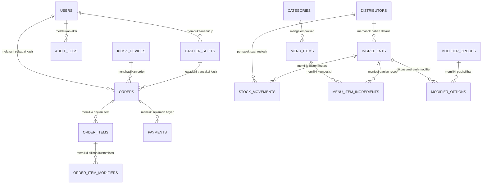

# Panduan Komprehensif & Catatan Arsitektur Sistem Our Coffee
> **Dokumen Studi & Referensi Teknis (Comprehensive Codebase Study Guide)**  
> Disusun untuk keperluan penguasaan arsitektur, persiapan sidang/presentasi tugas akhir/skripsi, serta panduan pengembangan (*extensibility guide*) aplikasi **Our Coffee**.

---

## DAFTAR ISI
1. [Ringkasan Eksekutif & Domain Masalah](#1-ringkasan-eksekutif--domain-masalah)
2. [Arsitektur Perangkat Lunak & Design Pattern](#2-arsitektur-perangkat-lunak--design-pattern)
3. [Analisis Mendalam Framework & Teknologi: Apa, Bagaimana, & Mengapa](#3-analisis-mendalam-framework--teknologi-apa-bagaimana--mengapa)
4. [Pohon Direktori Lengkap & Penjelasan File](#4-pohon-direktori-lengkap--penjelasan-file)
5. [Skema Basis Data & Relasi Eloquent (Data Layer)](#5-skema-basis-data--relasi-eloquent-data-layer)
6. [Bedah Logika Bisnis: 8 Service Layer Utama](#6-bedah-logika-bisnis-8-service-layer-utama)
7. [Alur Transaksi & State Machine (Life Cycle of an Order)](#7-alur-transaksi--state-machine-life-cycle-of-an-order)
8. [Frontend Architecture, State & Real-Time Polling](#8-frontend-architecture-state--real-time-polling)
9. [Panduan Menjawab Pertanyaan Dosen (Defense Q&A Guide)](#9-panduan-menjawab-pertanyaan-dosen-defense-qa-guide)
10. [Panduan Menambah Fitur Baru (How-To Tutorial)](#10-panduan-menambah-fitur-baru-how-to-tutorial)
11. [Kredensial Default & Perintah Esensial](#11-kredensial-default--perintah-esensial)

---

## 1. RINGKASAN EKSEKUTIF & DOMAIN MASALAH

### 1.1 Apa Itu Our Coffee?
**Our Coffee** adalah sistem operasional coffee shop *omnichannel* terintegrasi berbasis web responsif modern. Aplikasi ini menggabungkan seluruh titik interaksi (*touchpoints*) bisnis kafe ke dalam satu basis data dan satu alur logika yang sinkron secara *real-time*:
1. **Self-Service Kiosk (`/kiosk`)**: Layar sentuh mandiri bagi pelanggan untuk memilih menu, meracik modifier (opsi rasa/susu/ukuran), mengisi nama panggilan, dan memilih metode pembayaran.
2. **Point of Sale / POS Kasir (`/pos`)**: Antarmuka kasir untuk memproses pesanan langsung (*walk-in*), menyelesaikan pembayaran pesanan yang berasal dari Kiosk (khususnya bayar Tunai di Kasir), manajemen buka/tutup shift kasir, cetak struk termal, dan pembatalan pesanan (*void*).
3. **Kitchen Display System / KDS (`/kds`)**: Layar dapur dan meja barista untuk memantau tiket pesanan masuk, mengubah status pengerjaan (*Paid* $\rightarrow$ *Preparing* $\rightarrow$ *Ready* $\rightarrow$ *Completed*), dan fitur *undo* 1 langkah jika terjadi kesalahan ketuk.
4. **Queue Display TV (`/display/queue`)**: Layar publik di atas konter pengambilan untuk menampilkan nomor antrean yang sedang disiapkan dan nomor yang sudah siap dipanggil.
5. **Back-Office Admin (`/admin`)**: Dashboard analitik laba kotor, manajemen katalog menu & kategori, manajemen bahan baku (inventaris & kartu stok), pengaturan resep (*Bill of Materials* / BOM), manajemen staf & otorisasi PIN 6 digit, log audit yang tidak dapat diubah (*immutable*), dan laporan penjualan yang dapat diekspor ke Excel/CSV.

### 1.2 Masalah Riil yang Dipecahkan
- **Pencegahan Human Error & Antrean Panjang**: Memindahkan beban pemesanan dari antrean kasir ke mesin Kiosk pelanggan.
- **Transparansi Bahan Baku & HPP (BOM Costing)**: Setiap cangkir kopi yang terjual secara otomatis menghitung HPP (*Cost of Goods Sold*) berdasarkan takaran resep gram/ml bahan dan memotong stok fisik secara otomatis saat pembayaran lunas.
- **Pencegahan *Theft* dan Kebocoran Kas**: Kasir tidak dapat memanipulasi diskon atau membatalkan (*void*) pesanan yang sudah bayar tanpa verifikasi PIN 6-digit Supervisor/Admin. Seluruh aksi sensitif dicatat ke dalam `audit_logs`.
- **Integritas Konkurensi**: Tidak akan terjadi penjualan melebihi kapasitas stok (*overselling*) saat beberapa pelanggan memesan menu yang sama secara bersamaan.

---

## 2. ARSITEKTUR PERANGKAT LUNAK & DESIGN PATTERN

```
+-----------------------------------------------------------------------------------+
|                                  CLIENT LAYER                                     |
|  [ Kiosk Screen ]   [ POS Kasir ]   [ KDS Barista ]   [ Queue TV ]   [ Admin CMS] |
|                                (React 19 + TypeScript)                            |
+-----------------------------------------------------------------------------------+
                                          |
                      Inertia.js Protocol (X-Inertia Request/Response)
                                          |
+-----------------------------------------------------------------------------------+
|                                 ROUTING & MIDDLEWARE                              |
|  - Role Guard (EnsureUserHasRole: admin, kasir, barista)                          |
|  - Shift Guard (EnsureShiftIsOpen)                                                |
|  - Device Guard (EnsureKioskDevice via Device Token)                              |
+-----------------------------------------------------------------------------------+
                                          |
+-----------------------------------------------------------------------------------+
|                             CONTROLLER LAYER (Thin)                               |
|  - Validasi HTTP Request & Form Input                                             |
|  - Delegasi eksekusi ke Service Layer                                             |
|  - Mengembalikan Inertia::render() atau Redirect Response                         |
+-----------------------------------------------------------------------------------+
                                          |
+-----------------------------------------------------------------------------------+
|                              SERVICE LAYER (Domain Logic)                         |
|  OrderService | InventoryService | BomCostService | MenuAvailabilityService       |
|  QueueNumberGenerator | PinAuthorizationService | AuditLogService | QrisGateway   |
+-----------------------------------------------------------------------------------+
                                          |
+-----------------------------------------------------------------------------------+
|                            DATA & REPOSITORY LAYER                                |
|  - Eloquent ORM Models (Relationships, Casts, Mutators, Scopes)                   |
|  - Database Transactions (DB::transaction)                                        |
|  - Concurrency Locking (lockForUpdate - Pessimistic Locking)                      |
|  - MySQL / MariaDB (InnoDB Storage Engine)                                        |
+-----------------------------------------------------------------------------------+
```

### 2.1 Pola-Pola Desain Utama yang Diterapkan
1. **Service Layer Pattern**: Logika bisnis tidak ditulis di Controller maupun di Model, melainkan dipusatkan di folder `app/Services/`. Ini memastikan prinsip *Single Responsibility* dan kode dapat digunakan kembali (*reusable*) baik oleh POS, Kiosk, maupun Seeder/Testing.
2. **Contract / Interface-Driven Architecture**: Digunakan pada `QrisGatewayInterface` yang diimplementasikan oleh `SimulatedQrisGateway`. Pola ini memudahkan integrasi payment gateway pihak ketiga (seperti Midtrans, Xendit, atau DOKU) tanpa merombak `OrderService`.
3. **Pessimistic Locking (`lockForUpdate`)**: Menjamin integritas data stok bahan baku dan penomoran antrean di lingkungan multi-user yang konkuren.
4. **Deadlock Prevention (Ordered Lock Acquisition)**: Dalam pemotongan stok bahan baku di `InventoryService::deductForOrder()`, array ID bahan baku selalu diurutkan (`sort($ingredientIds)`) sebelum dikunci dengan `lockForUpdate()`. Ini mematahkan kondisi *Circular Wait* pada teori deadlock basis data.
5. **State Pattern & Explicit Transition Matrix**: Status pesanan (`OrderStatus`) dikontrol melalui matriks transisi yang ketat. KDS hanya dapat mengubah status sesuai alur yang ditentukan dan mendukung pembatalan 1 langkah (*undo*).
6. **Immutable Audit Logging**: Entri `audit_logs` merekam siapa melakukan apa, siapa yang mengotorisasi via PIN, data sebelum/sesudah, dan alamat IP. Tidak ada API atau UI untuk mengubah atau menghapus audit log.

---

## 3. ANALISIS MENDALAM FRAMEWORK & TEKNOLOGI: APA, BAGAIMANA, & MENGAPA

Bagian ini membahas secara komprehensif seluruh teknologi, framework, dan pustaka (*libraries*) yang digunakan dalam proyek **Our Coffee**. Setiap teknologi diuraikan dengan format: **Apa itu**, **Bagaimana implementasinya di proyek ini**, dan **Mengapa dipilih dibandingkan alternatifnya**.

---

### 3.1 PHP 8.3 & Laravel 13 (Backend Core & Enterprise Engine)

#### A. Apa Itu?
- **PHP 8.3**: Versi modern dari bahasa pemrograman PHP yang telah berevolusi menjadi bahasa berorientasi objek yang ketat (*strictly typed*), berkinerja tinggi berkat mesin JIT (*Just-In-Time Compiler*), serta mendukung fitur-fitur modern seperti *Typed Class Constants*, *Readonly Classes*, *Pattern Matching (`match`)*, dan *Constructor Property Promotion*.
- **Laravel 13 (`laravel/framework: ^13.17`)**: Framework web PHP open-source nomor satu di dunia yang mengadopsi pola MVC (*Model-View-Controller*), dirancang dengan fokus pada keanggunan sintaksis (*developer happiness*), keamanan tinggi bawaan, dan ekosistem enterprise yang matang.

#### B. Bagaimana Digunakan dalam Our Coffee?
1. **Penerapan *Strict Types* & Modern OOP**:
   Seluruh berkas PHP diawali dengan `declare(strict_types=1);`. Dependency Injection diinjeksikan secara rapi menggunakan *Constructor Property Promotion*:
   ```php
   // Contoh dari app/Services/OrderService.php
   public function __construct(
       private readonly BomCostService $bomCostService,
       private readonly MenuAvailabilityService $availabilityService,
       private readonly InventoryService $inventoryService,
       private readonly QueueNumberGenerator $queueNumberGenerator,
       private readonly QrisGatewayInterface $qrisGateway,
       private readonly PinAuthorizationService $pinAuthorizationService,
       private readonly AuditLogService $auditLogService,
   ) {}
   ```
2. **Type-Safe Backed Enums**:
   Memanfaatkan PHP 8.1+ Enums untuk 10 tipe data penting kafe (`OrderStatus`, `PaymentMethod`, `StockMovementType`, `UserRole`, dll.) sehingga tidak ada lagi nilai string mentah (*magic strings*) yang rawan *typo*.
3. **Database Transactions & Concurrency Control**:
   Memanfaatkan `DB::transaction()` dan klausa `lockForUpdate()` milik Laravel Eloquent untuk menjamin operasi perbankan/stok bersifat ACID.
4. **Middleware Pipeline**:
   Mengatur otentikasi peran staf (`EnsureUserHasRole`), pengecekan shift kasir aktif (`EnsureShiftIsOpen`), dan identifikasi fisik mesin kios (`EnsureKioskDevice`).

#### C. Mengapa Memilih Laravel 13? (Justifikasi & Analisis Komparatif)
- **Keamanan Enterprise Bawaan**: Laravel secara otomatis melindungi aplikasi dari serangan web paling mematikan:
  - *SQL Injection*: Dicegah oleh PDO Parameter Binding pada Eloquent ORM.
  - *Cross-Site Request Forgery (CSRF)*: Token diverifikasi otomatis pada setiap request POST/PUT/DELETE.
  - *Cross-Site Scripting (XSS)*: Sanitasi data otomatis.
  - *Session Hijacking*: Session cookie terenkripsi dan berstatus `HTTP-Only` + `SameSite=Lax`.
- **Ekosistem Lengkap (Batteries Included)**: Menyediakan sistem migrasi database terstruktur, seeder, sistem otentikasi (Laravel Fortify), rate limiting (throttle), task scheduling, dan ORM tanpa perlu menginstal puluhan paket pihak ketiga secara manual.

#### D. Perbandingan dengan Alternatif:
| Framework / Bahasa | Kelebihan | Kelemahan Dibanding Laravel 13 di Our Coffee |
| :--- | :--- | :--- |
| **Express.js / Node.js** | Ringan, I/O non-blocking, bahasa sama dengan frontend (JavaScript). | **Tidak memiliki struktur standar.** Developer harus merakit sendiri ORM (Prisma/TypeORM), auth, migrasi, dan validasi. Rawan inkonsistensi arsitektur dan rentan terhadap *callback hell* atau *unhandled promise rejections* pada transaksi basis data kompleks. |
| **Django (Python)** | Built-in Admin panel yang cepat, ORM yang kuat. | Tidak memiliki adapter modern sekelas Inertia.js yang se-matang ekosistem Laravel. Manipulasi UI reaktif di Django sering kali membutuhkan REST API/GraphQL terpisah atau template server render yang kaku. |
| **Spring Boot (Java)** | Performa sangat tinggi untuk skala perbankan raksasa. | **Overhead konfigurasi yang masif (*over-engineering*).** Waktu pengembangan (*time-to-market*) sangat lambat, konsumsi RAM server sangat besar (bisa >1-2 GB hanya untuk idle), tidak cocok untuk kelincahan operasional kafe. |

---

### 3.2 Inertia.js v3 (The Modern Monolith Bridge)

#### A. Apa Itu?
**Inertia.js** (`@inertiajs/react: ^3.0.0` & `inertiajs/inertia-laravel: ^3.0`) adalah pustaka revolusioner yang berfungsi sebagai jembatan (*glue*) antara backend framework klasik (Laravel) dengan pustaka frontend modern berbasis komponen (React). Inertia dijuluki sebagai **"The Modern Monolith"**.

#### B. Bagaimana Digunakan dalam Our Coffee?
- Alih-alih membuat REST API yang mengembalikan JSON mentah melalui endpoint terpisah seperti `/api/pos/orders`, Controller Laravel langsung memanggil `Inertia::render()`:
  ```php
  // app/Http/Controllers/Pos/PosController.php
  return Inertia::render('pos/index', [
      'categories' => $categories,
      'menuItems' => $menuItems,
      'pendingKioskOrders' => $pendingKioskOrders,
  ]);
  ```
- Di sisi frontend React (`resources/js/pages/pos/index.tsx`), halaman menerima data tersebut sebagai **React Props biasa**:
  ```tsx
  export default function PosIndex({ categories, menuItems, pendingKioskOrders }: PosProps) {
      // Langsung dapat digunakan tanpa useEffect atau fetch() manual!
  }
  ```
- Saat kasir melunasi pesanan atau menekan tombol, pengiriman data dilakukan menggunakan `router.post()` dari Inertia. Browser **tidak melakukan full page reload**, melainkan hanya melakukan AJAX request khusus yang mengembalikan data baru secara parsial.

#### C. Mengapa Memilih Inertia.js?
1. **Menghilangkan Duplikasi Pekerjaan REST API**: Pada aplikasi SPA tradisional, developer harus:
   - Membuat Route Web + Route API.
   - Membuat Controller API + API Resources / DTO Transformer.
   - Mengatur CORS (*Cross-Origin Resource Sharing*).
   - Mengatur autentikasi berbasis JWT (JSON Web Token) atau OAuth2.
   - Membuat fungsi `fetch()` / `axios` di frontend beserta state `isLoading`, `isError`, dan `data`.
   *Dengan Inertia.js, 100% kerumitan di atas hilang!*
2. **Keamanan Jauh Lebih Unggul daripada SPA Terpisah**:
   - Pada SPA terpisah, token JWT sering kali disimpan di `localStorage` browser, yang mana sangat rentan dicuri lewat serangan **XSS (Cross-Site Scripting)**.
   - Inertia tetap menggunakan mekanisme sesi berbasis cookie bawaan Laravel (`laravel_session`) yang dilindungi flag `HttpOnly`, `Secure`, dan `SameSite`, sehingga JavaScript berbahaya sama sekali tidak bisa membaca data sesi otentikasi.
3. **Single Source of Truth**: State data berada di server (database). Data yang dikirim ke halaman React dijamin selalu segar dan konsisten dengan aturan otorisasi server.

#### D. Perbandingan dengan Alternatif:
- **Vs Blade Template (Laravel Klasik)**: Blade me-render ulang seluruh halaman HTML setiap kali pengguna mengeklik link atau submit form. Pada layar POS dan Kiosk, layar akan berkedip putih (*flash/reload*), merusak pengalaman pengguna kasir dan pelanggan yang membutuhkan responsivitas instan secepat aplikasi mobile native.
- **Vs SPA REST API Terpisah (Next.js / Vite SPA Standalone)**: Membutuhkan pemeliharaan 2 repositori atau 2 build pipeline yang berbeda. Jika skema database di backend berubah, frontend sering kali mengalami error diam-diam (*silent failure*) karena ketidakcocokan tipe data JSON.

---

### 3.3 React 19 & TypeScript 5.7 (Frontend Component Layer & Type Safety)

#### A. Apa Itu?
- **React 19 (`react: ^19.2.0`)**: Rilis mayor terbaru dari pustaka antarmuka pengguna berbasis komponen deklaratif yang dikembangkan oleh Meta. Menghadirkan efisiensi rendering terbaik dan integrasi kompiler modern.
- **TypeScript 5.7 (`typescript: ^5.7.2`)**: Bahasa superset dari JavaScript yang menambahkan sistem tipe statis (*static typing*) pada waktu kompilasi (*compile-time*).

#### B. Bagaimana Digunakan dalam Our Coffee?
1. **Arsitektur Komponen Modular**:
   Antarmuka Kiosk, POS, KDS, dan Display TV dibagi menjadi komponen-komponen kecil yang dapat digunakan kembali (*reusable*):
   - `components/pos/num-pad.tsx`: Papan tombol angka interaktif untuk pembayaran uang tunai kasir.
   - `components/pos/supervisor-pin-modal.tsx`: Modal verifikasi PIN 6 digit admin.
   - `components/pos/thermal-receipt.tsx`: Tampilan struk belanja yang diformat presisi untuk printer kasir 58mm/80mm.
   - `components/kiosk/modifier-sheet.tsx`: Bottom sheet/modal pemilihan varian gula, es, dan susu.
2. **Definisi Kontrak Data Kuat (Type Contracts)**:
   Semua data dari backend memiliki interface TypeScript yang ketat (`resources/js/types/index.ts`):
   ```typescript
   export interface MenuItem {
       id: number;
       category_id: number;
       name: string;
       price: number;
       cost_estimate: number;
       is_available: boolean;
       recipe_items?: MenuItemIngredient[];
   }
   ```

#### C. Mengapa Memilih React 19 & TypeScript?
1. **Reaktivitas Antarmuka Kasir & Kiosk yang Kompleks**:
   Di layar Kiosk, saat pelanggan memilih menu *Kopi Susu* lalu mencentang *Oat Milk (+Rp 6.000)* dan *Double Shot (+Rp 5.000)*, total harga belanja harus langsung berubah secara instan tanpa ada jeda. Pola deklaratif React (`UI = f(state)`) menjamin tampilan selalu sinkron dengan state data.
2. **Pencegahan Bug Finansial Berbahaya**:
   Pada JavaScript biasa, operasi angka sangat rentan menghasilkan bug fatal:
   `const total = price + modifier;` $\rightarrow$ Jika `modifier` tidak sengaja bertipe string `"5000"`, hasilnya menjadi `"250005000"` (bukan `30000`). TypeScript mendeteksi kesalahan tipe ini langsung di editor sebelum kode sempat dijalankan.
3. **Refactoring Tanpa Rasa Takut**:
   Ketika nama atribut di backend diubah, TypeScript Compiler (`tsc --noEmit`) akan langsung memberitahukan seluruh baris kode frontend mana saja yang terdampak dan perlu disesuaikan.

---

### 3.4 Tailwind CSS v4 & Rust Oxide Engine (Design System & Styling)

#### A. Apa Itu?
**Tailwind CSS v4 (`tailwindcss: ^4.0.0`)** adalah generasi terbaru dari framework CSS *utility-first*. Pada versi 4, arsitektur Tailwind telah ditulis ulang sepenuhnya menggunakan bahasa pemrograman berkinerja tinggi **Rust** melalui engine baru bernama **Oxide**, menghilangkan kebutuhan berkas konfigurasi JavaScript `tailwind.config.js` yang rumit.

#### B. Bagaimana Digunakan dalam Our Coffee?
1. **Palet Warna Mewah Khas Kafe (*Amber & Charcoal Theme*)**:
   Warna didefinisikan menggunakan CSS Variable modern di `resources/css/app.css`:
   - Latar belakang gelap elegan: `bg-stone-950`, `bg-[#1c1917]`
   - Aksen kopi hangat: `amber-500`, `amber-600`, `orange-600`
   - Kontras teks tinggi: `text-stone-100`, `text-amber-400`
2. **Tipografi Khusus Mata Uang (`font-money`)**:
   Dibuat class khusus `.font-money` yang menggunakan fitur OpenType `font-variant-numeric: tabular-nums;`. Ini memastikan seluruh digit angka Rupiah memiliki lebar yang sama persis, sehingga kolom angka pada tabel laporan dan struk belanja tersusun sejajar lurus ke bawah.
3. **Cetak Struk Termal Ramah Cetak (`@media print`)**:
   Pengaturan khusus di CSS agar saat tombol "Cetak Struk" ditekan, browser hanya mencetak elemen struk thermal (`.thermal-receipt`) dan menyembunyikan seluruh sidebar navigasi kasir, tombol, dan header.

#### C. Mengapa Memilih Tailwind CSS v4?
1. **Zero CSS Bloat (Ukuran File Minimal)**: Tailwind hanya mengompilasi kelas CSS yang benar-benar digunakan dalam kode JSX. Hasil berkas CSS akhir sangat kecil (<30-50 KB), mempercepat waktu muat awal pada perangkat tablet Kiosk atau smartphone kasir yang terkoneksi Wi-Fi kafe.
2. **Bebas Masalah *Naming Fatigue***: Pengembang tidak perlu membuang waktu memikirkan nama class seperti `.order-container-card-inner-box-v2`. Semua styling ditulis langsung menggunakan kelas utilitas deklaratif (`flex items-center justify-between p-4 rounded-xl`).
3. **Konsistensi Desain**: Seluruh margin, padding, border radius, dan ukuran font berpedoman pada skala standar yang harmonis.

---

### 3.5 Zustand 5 (Reactive Client State Management)

#### A. Apa Itu?
**Zustand (`zustand: ^5.1.0`)** adalah pustaka manajemen state sisi klien (*client-side state management*) untuk React yang sangat cepat, berbasis kait (*hook-based*), dan berukuran sangat kecil (kurang dari 1 KB).

#### B. Bagaimana Digunakan dalam Our Coffee?
Zustand digunakan secara eksklusif untuk mengelola keranjang belanja mandiri di layar Kiosk (`resources/js/stores/kiosk-cart-store.ts`):
```typescript
interface KioskCartStore {
    orderType: 'dine_in' | 'takeaway';
    customerName: string;
    items: CartItem[];
    addItem: (item: Omit<CartItem, 'id'>) => void;
    removeItem: (id: string) => void;
    updateQuantity: (id: string, delta: number) => void;
    clearCart: () => void;
    subtotal: () => number;
}
```
Komponen kartu menu, modal modifier, dan ringkasan keranjang dapat membaca dan memperbarui keranjang dari komponen mana saja tanpa perlu mengoper props ke bawah (*prop drilling*).

#### C. Mengapa Memilih Zustand Dibanding Redux atau Context API?
- **Vs Redux Toolkit**: Redux memiliki *boilerplate* yang luar biasa masif (Actions, Reducers, Dispatchers, Slice, Store Provider). Untuk aplikasi Kiosk, Redux adalah contoh klasik *over-engineering* yang memperlambat kode.
- **Vs React Context API**: Context API memiliki cacat performa bawaan: setiap kali salah satu nilai di Context berubah (misal pelanggan menambah 1 pcs gula), **seluruh komponen anak** yang berada di dalam Provider tersebut akan dipaksa untuk me-render ulang (*unnecessary re-renders*). Pada perangkat Kiosk layar sentuh bertipe tablet murah/layar All-In-One industri, hal ini menyebabkan UI terasa tersendat (*laggy*). Zustand mengeliminasi masalah ini karena komponen hanya me-render ulang jika bagian data (*slice*) yang dilanggannya benar-benar berubah.

---

### 3.6 Radix UI Primitives & Shadcn UI (Headless Accessible Architecture)

#### A. Apa Itu?
- **Radix UI (`@radix-ui/react-*`)**: Pustaka komponen primitif *headless* (tanpa gaya bawaan) yang dirancang khusus untuk memenuhi standar aksesibilitas internasional tertinggi (**WAI-ARIA**).
- **Shadcn UI**: Paradigma arsitektur UI modern di mana kode komponen tidak diinstal sebagai pustaka `node_modules` yang tertutup, melainkan disalin (*copy-paste/scaffolded*) langsung ke dalam folder proyek (`resources/js/components/ui/`), memberikan kendali penuh 100% kepada developer atas markup dan styling-nya.

#### B. Bagaimana Digunakan dalam Our Coffee?
Komponen krusial seperti Dialog Modal (`@radix-ui/react-dialog`), Dropdown Menu (`@radix-ui/react-dropdown-menu`), Tooltip, dan Popover diintegrasikan ke dalam:
- Modal konfirmasi tutup shift kasir.
- Modal verifikasi PIN 6 digit admin.
- Lembar kustomisasi modifier menu di Kiosk.

#### C. Mengapa Memilih Radix UI?
1. **Aksesibilitas & Keyboard Navigation Otomatis**: Menangani perilaku rumit secara native:
   - *Focus Trapping*: Kursor keyboard tidak bisa melompat keluar dari modal yang sedang terbuka.
   - *Esc Key Listener*: Menekan tombol Escape otomatis menutup dialog.
   - *Screen Reader Friendly*: Atribut ARIA (`aria-expanded`, `aria-haspopup`, `role="dialog"`) terpasang dengan benar.
2. **Kustomisasi Tanpa Batas**: Berbeda dengan pustaka seperti Bootstrap atau Ant Design yang memaksakan warna dan bentuk tombol mereka, Radix UI tidak memiliki opini styling sama sekali. Kita bebas mewarnainya dengan tema amber/kopi menggunakan Tailwind CSS.

---

### 3.7 MySQL 8.0 / MariaDB 10.11+ dengan InnoDB Engine (Relational Storage)

#### A. Apa Itu?
Sistem manajemen basis data relasional (*Relational Database Management System* / RDBMS) berstandar industri dengan mesin penyimpanan **InnoDB** yang mendukung penuh transaksi ACID (*Atomicity, Consistency, Isolation, Durability*).

#### B. Bagaimana Digunakan dalam Our Coffee?
- Mengelola 18 tabel domain yang saling berelasi dengan kunci asing (*Foreign Keys*).
- Menjalankan penguncian pesimistik tingkat baris (*Row-Level Pessimistic Locking*) via `SELECT ... FOR UPDATE` saat pemotongan stok bahan baku dan penomoran antrean.

#### C. Mengapa Memilih RDBMS Relasional Dibanding NoSQL (MongoDB)?
- **Integritas Transaksional Keuangan**: Dalam bisnis kafe, pesanan melibatkan uang, pemotongan stok bahan, pencatatan mutasi, dan pembukuan kasir. Jika kasir menerima uang tetapi koneksi terputus saat memotong stok, transaksi harus di-*rollback* total (**Atomicity**).
- **Relasi Kompleks yang Alami**: Resep Bill of Materials (BOM) adalah relasi relasional murni: *Satu Menu memiliki Banyak Resep, Satu Resep merujuk ke Satu Bahan Baku*. Di MongoDB (NoSQL), jika data bahan baku diduplikasi (*denormalized*) ke dalam dokumen menu, maka saat harga beli kopi naik dari distributor, kita harus memperbarui ribuan dokumen menu secara manual yang rawan inkonsistensi (*data anomaly*).

---

### 3.8 Pest PHP 5, Larastan 3 & Pint (Code Quality & Verification Engine)

#### A. Apa Itu?
- **Pest PHP (`pestphp/pest: ^5.3`)**: Framework pengujian PHP modern dengan sintaks berbasis penutupan fungsional (*functional closures*) yang sangat ekspresif, dibangun di atas PHPUnit.
- **Larastan (`larastan/larastan: ^3.9`)**: Alat analisis statis berbasis PHPStan yang memahami keajaiban magis Eloquent Laravel, mendeteksi potensi bug sebelum kode dijalankan.
- **Laravel Pint (`laravel/pint: ^1.27`)**: Linter dan formatter kode otomatis berbasis standar industri PHP PSR-12.

#### B. Bagaimana Digunakan dalam Our Coffee?
Proyek ini dilengkapi dengan **72 automated tests** (`tests/Feature/` dan `tests/Unit/`) yang menguji seluruh skenario nyata:
- Pengecekan stok bahan baku berkurang dengan benar saat pembayaran lunas.
- Penolakan akses Kiosk jika cookie token tidak valid.
- Penolakan akses POS jika kasir belum membuka shift.
- Penolakan void pesanan jika PIN admin salah.

#### C. Mengapa Ini Penting untuk Sidang / Penilaian Dosen?
Menunjukkan kepada dosen penguji bahwa aplikasi ini tidak hanya "tampak berjalan di layar", tetapi memiliki **jaminan kualitas perangkat lunak (*Software Quality Assurance*)** berstandar industri yang terverifikasi lewat *automated regression testing*.

---

### 3.9 Vite & Tooling Ekosistem Modern

#### A. Apa Itu?
**Vite (`vite: 1.4.0`)** adalah build tool frontend modern yang memanfaatkan fitur native ES Modules pada browser modern untuk menghadirkan kompilasi secepat kilat.

#### B. Mengapa Memilih Vite Dibanding Webpack?
- **Instant Hot Module Replacement (HMR)**: Saat developer mengedit tampilan React atau CSS, perubahan langsung muncul di browser dalam hitungan milidetik tanpa perlu me-reload seluruh halaman dan tanpa kehilangan state form yang sedang diisi.
- **Waktu Build Super Cepat**: Menggunakan bundler berbasis Rollup/Rust yang jauh lebih hemat memori dan berlipat-lipat lebih cepat dibanding Webpack konvensional.

---

### 3.10 Matriks Perbandingan & Alasan Pemilihan Stack (Executive Summary Matrix)

| Komponen Arsitektur | Teknologi Terpilih | Alternatif yang Ditolak | Alasan Utama Pemilihan |
| :--- | :--- | :--- | :--- |
| **Backend Framework** | **Laravel 13 (PHP 8.3)** | Express.js / Django / Spring Boot | Ekosistem paling terintegrasi, fitur keamanan bawaan lengkap (CSRF/Auth/DB Transactions), dan ORM Eloquent yang sangat ekspresif. |
| **Arsitektur Integrasi** | **Inertia.js v3** | REST API Standalone / Blade SSR | Menghapus overhead pembuatan API ganda, keamanan berbasis session HTTP-Only yang anti-XSS, dan rendering secepat SPA tanpa kedipan reload. |
| **Frontend UI Library** | **React 19 + TypeScript** | Vue.js / Blade / Vanilla JS | Komponen deklaratif yang reaktif untuk kalkulator modifier Kiosk, ditambah type-safety ketat TypeScript untuk mencegah bug salah hitung nominal uang. |
| **Styling & CSS** | **Tailwind CSS v4** | Bootstrap 5 / Custom CSS | Engine baru berbasis Rust (Oxide) yang super cepat, zero CSS bloat, dan fleksibilitas penuh membuat tampilan bertema kafe premium. |
| **Client State (Kiosk)** | **Zustand 5** | Redux Toolkit / Context API | Ukuran <1KB, bebas boilerplate action/reducer yang berbelit, dan mencegah lag re-render pada layar sentuh kios. |
| **Komponen UI Primitif** | **Radix UI (Shadcn)** | Material UI (MUI) / Ant Design | Kepatuhan aksesibilitas internasional (WAI-ARIA), keyboard navigation otomatis, dan bebas dari opini styling bawaan yang kaku. |
| **Basis Data** | **MariaDB / MySQL (InnoDB)**| MongoDB (NoSQL) / SQLite | Mendukung transaksi ACID perbankan penuh, pencegahan deadlock lewat penguncian baris (`lockForUpdate`), dan relasi ternormalisasi 3NF. |
| **Pengujian Otomatis** | **Pest PHP 5** | Pengujian Manual / PHPUnit murni | Sintaks pengujian deklaratif yang elegan dan ekspresif untuk menguji 72 skenario bisnis secara otomatis dalam hitungan detik. |

---

## 4. POHON DIREKTORI LENGKAP & PENJELASAN FILE

Berikut adalah peta struktur berkas utama proyek Our Coffee beserta fungsi teknisnya:

```
Our-Coffee/
├── app/
│   ├── Contracts/
│   │   └── QrisGatewayInterface.php        # Kontrak standar untuk gateway pembayaran QRIS
│   ├── Enums/                              # Tipe data terstandarisasi (Type-safe Enum PHP 8.1+)
│   │   ├── CashierShiftStatus.php          # Open, Closed
│   │   ├── IngredientUnit.php              # Gram (g), Mililiter (ml), Pieces (pcs)
│   │   ├── MenuBadge.php                   # BestSeller, New, Promo, Recommended
│   │   ├── ModifierSelectionType.php       # Single (radio), Multiple (checkbox)
│   │   ├── OrderChannel.php                # Kiosk, Pos
│   │   ├── OrderStatus.php                 # PendingPayment, Paid, Preparing, Ready, Completed, Cancelled, Voided
│   │   ├── OrderType.php                   # DineIn, Takeaway
│   │   ├── PaymentMethod.php               # Cash, Qris
│   │   ├── PaymentStatus.php               # Pending, Paid, Expired, Failed, Refunded
│   │   ├── StockMovementType.php           # Restock, Sale, Waste, Opname
│   │   └── UserRole.php                    # Admin, Kasir, Barista
│   ├── Exceptions/                         # Custom Exception untuk penanganan error domain
│   │   ├── InvalidOrderTransitionException.php # Terlempar jika status order melompat ilegal
│   │   ├── InvalidPinException.php             # Terlempar jika PIN Supervisor salah
│   │   └── StockConflictException.php          # Terlempar jika bahan baku habis saat checkout/bayar
│   ├── Http/
│   │   ├── Controllers/
│   │   │   ├── Admin/                      # Modul Manajemen Back-Office
│   │   │   │   ├── AuditLogController.php      # Menampilkan daftar audit trail sensitif
│   │   │   │   ├── CategoryController.php      # CRUD kategori menu
│   │   │   │   ├── DashboardController.php     # Ringkasan omzet, laba kotor, item terlaris
│   │   │   │   ├── DistributorController.php   # Data supplier bahan baku
│   │   │   │   ├── InventoryController.php     # CRUD bahan baku, restock, waste, opname fisik
│   │   │   │   ├── MenuItemController.php      # CRUD menu, upload foto, toggle aktif, resep BOM
│   │   │   │   ├── ModifierGroupController.php # CRUD opsi tambahan (sugar, ice, topping)
│   │   │   │   ├── ReportController.php        # Laporan penjualan, filter tanggal, ekspor CSV
│   │   │   │   ├── SettingsController.php      # Pengaturan toko & pairing perangkat Kiosk
│   │   │   │   └── StaffController.php         # Manajemen akun staf & ganti PIN 6 digit
│   │   │   ├── Display/
│   │   │   │   └── QueueDisplayController.php  # Layar TV antrean & feed polling JSON
│   │   │   ├── Kds/
│   │   │   │   └── KdsController.php           # Layar dapur KDS & endpoint transisi status
│   │   │   ├── Kiosk/
│   │   │   │   └── KioskController.php         # Layar sentuh pelanggan, checkout, QRIS, exit PIN
│   │   │   └── Pos/
│   │   │       ├── CashierShiftController.php  # Buka shift kasir, hitung rekonsiliasi kas, tutup shift
│   │   │       └── PosController.php           # Pemesanan walk-in, pembayaran kiosk, void order
│   │   └── Middleware/
│   │       ├── EnsureKioskDevice.php       # Memeriksa cookie token perangkat Kiosk terpasang
│   │       ├── EnsureShiftIsOpen.php       # Memblokir akses POS jika kasir belum buka shift
│   │       ├── EnsureUserHasRole.php       # RBAC memeriksa role: admin, kasir, atau barista
│   │       ├── HandleAppearance.php        # Pengaturan mode tema (dark/light)
│   │       └── HandleInertiaRequests.php   # Berbagi session props, auth user, dan flash toast ke React
│   ├── Models/                             # 17 Eloquent Model (Entity Representatif Database)
│   │   ├── AppSetting.php                  # Konfigurasi key-value aplikasi (nama kafe, pajak, dll)
│   │   ├── AuditLog.php                    # Catatan permanen tindakan staf
│   │   ├── CashierShift.php                # Rekaman shift kasir beserta modal awal & setoran akhir
│   │   ├── Category.php                    # Kategori menu makanan/minuman
│   │   ├── Distributor.php                 # Pemasok bahan baku
│   │   ├── Ingredient.php                  # Data stok bahan baku, satuan, dan biaya per unit
│   │   ├── KioskDevice.php                 # Entitas mesin kiosk fisik yang di-pairing token
│   │   ├── MenuItem.php                    # Data menu, harga jual, status ketersediaan
│   │   ├── MenuItemIngredient.php          # Tabel pivot Bill of Materials (Resep: Menu -> Bahan)
│   │   ├── ModifierGroup.php               # Grup pilihan (contoh: Sugar Level, Milk Choice)
│   │   ├── ModifierOption.php              # Pilihan opsi (Normal Sugar, Oat Milk [+Rp 6.000])
│   │   ├── Order.php                       # Header transaksi penjualan (Nomor antrean, total, status)
│   │   ├── OrderItem.php                   # Detail menu yang dipesan beserta snapshot harga & HPP
│   │   ├── OrderItemModifier.php           # Detail modifier yang dipilih per item pesanan
│   │   ├── Payment.php                     # Detail pembayaran (Metode tunai/QRIS, jumlah, kembalian)
│   │   ├── StockMovement.php               # Buku besar mutasi stok bahan baku
│   │   └── User.php                        # Akun staf (Admin, Kasir, Barista) + PIN hash
│   └── Services/                           # Jantung Logika Bisnis (Domain Engine)
│       ├── AuditLogService.php             # Pencatat aktivitas audit yang tidak dapat diubah
│       ├── BomCostService.php              # Kalkulator HPP (COGS) dan margin keuntungan resep
│       ├── InventoryService.php            # Manajemen mutasi stok, restock, waste, dan deduct
│       ├── MenuAvailabilityService.php     # Deteksi otomatis ketersediaan menu berdasarkan stok
│       ├── OrderService.php                # Orkestrator pembuatan order, pelunasan, dan void
│       ├── PinAuthorizationService.php     # Validator PIN 6-digit Supervisor/Admin
│       ├── QueueNumberGenerator.php        # Generator nomor antrean unik harian berbasis lock
│       └── SimulatedQrisGateway.php        # Mock payment gateway QRIS untuk pengujian lokal
├── database/
│   ├── migrations/                         # 14 file migrasi skema tabel domain
│   └── seeders/                            # Seeder database untuk inisialisasi awal
│       ├── AppSettingSeeder.php            # Default pengaturan sistem
│       ├── CatalogAndInventorySeeder.php   # Katalog menu kopi, bahan baku, resep BOM
│       ├── DatabaseSeeder.php              # Master caller seeder
│       └── StaffSeeder.php                 # Akun default Owner, Kasir, dan Barista
├── resources/
│   ├── css/
│   │   └── app.css                         # Konfigurasi Tailwind CSS v4, tema amber/charcoal, font-money
│   └── js/
│       ├── components/                     # Reusable React UI Components
│       │   ├── kiosk/                      # Komponen khusus Kiosk (ModifierSheet, PinExitModal)
│       │   ├── pos/                        # Komponen khusus POS (NumPad, SupervisorPinModal, Struk Termal)
│       │   ├── ui/                         # Komponen basis Shadcn UI (Dialog, Button, Input, Table)
│       │   ├── app-logo.tsx                # Ikon & logo coffee shop
│       │   └── stock-level-bar.tsx         # Indikator visual level stok bahan baku
│       ├── hooks/                          # Custom React Hooks
│       │   ├── use-flash-toast.ts          # Menampilkan notifikasi flash message dari Laravel session
│       │   └── use-polling.ts              # Melakukan auto-refresh berkala (KDS, antrean POS, TV)
│       ├── layouts/                        # Template pembungkus halaman
│       │   ├── our-coffee-rail-layout.tsx  # Layout sidebar navigasi admin & kasir berdesain mewah
│       │   └── auth-layout.tsx             # Layout halaman login
│       ├── pages/                          # Halaman Tampilan Inertia.js (1-to-1 dengan Controller)
│       │   ├── admin/                      # Halaman manajemen admin (Dashboard, Menu, Bahan, Laporan)
│       │   ├── display/queue.tsx           # Layar Display Antrean TV
│       │   ├── kds/index.tsx               # Layar Kitchen Display System untuk barista
│       │   ├── kiosk/index.tsx             # Layar pemesanan mandiri pelanggan
│       │   └── pos/                        # Halaman POS (index.tsx) dan Buka/Tutup Shift (shift.tsx)
│       ├── stores/
│       │   └── kiosk-cart-store.ts         # Zustand store untuk keranjang belanja Kiosk
│       └── types/                          # Definisi interface TypeScript global
└── routes/
    ├── web.php                             # Seluruh route HTTP web aplikasi
    └── settings.php                        # Route profil pengguna
```

---

## 5. SKEMA BASIS DATA & RELASI ELOQUENT (DATA LAYER)

Basis data Our Coffee dirancang ternormalisasi (3NF) dengan integritas referensial yang kuat menggunakan *Foreign Keys* dan *Cascade Restrictions* untuk menjaga konsistensi keuangan kafe.



### 5.1 Tabel-Tabel Utama & Karakteristik Penting
1. **`ingredients`**:
   - Kolom: `id`, `name`, `unit` (g/ml/pcs), `current_stock` (DECIMAL 12,3), `cost_per_unit` (INT Rupiah), `minimum_stock_alert` (DECIMAL 12,3), `is_active`.
   - Menggunakan presisi 3 desimal untuk mendukung takaran akurat gram/mililiter (misal: 18.5 gram espresso beans atau 120.0 ml oat milk).
2. **`menu_item_ingredients` (Tabel Pivot BOM)**:
   - Kolom: `id`, `menu_item_id`, `ingredient_id`, `quantity` (DECIMAL 12,3).
   - Menghubungkan Menu ke Bahan Baku dengan kuantitas yang dibutuhkan per 1 porsi menu.
3. **`stock_movements` (Kartu Stok / Ledger Mutasi)**:
   - Kolom: `id`, `ingredient_id`, `type` (`restock`, `sale`, `waste`, `opname`), `quantity_change`, `stock_before`, `stock_after`, `unit_cost`, `total_cost`, `reference_type`, `reference_id`, `notes`, `created_by`.
   - Menjamin bahwa perubahan stok sekecil apa pun dapat diaudit asal-usulnya.
4. **`orders`**:
   - Kolom: `id`, `order_number` (format unik: `OC-YYYYMMDD-XXXX`), `queue_number` (format harian: `A-001`), `queue_date`, `channel` (`kiosk`, `pos`), `order_type` (`dine_in`, `takeaway`), `status` (`pending_payment`, `paid`, `preparing`, `ready`, `completed`, `cancelled`, `voided`), `subtotal`, `discount_amount`, `total_amount`, `cogs_total`, `cashier_shift_id`, `cashier_id`, `kiosk_device_id`.
5. **`order_items` & `order_item_modifiers`**:
   - Merekam **snapshot harga dan HPP** pada saat transaksi terjadi (`unit_price`, `unit_cogs`, `line_total`, `price_delta`).
   - *Penting*: Data ini tidak menggunakan relasi *live* ke harga menu saat ini, agar laporan laba masa lalu tidak berubah ketika harga menu diubah di masa depan!
6. **`cashier_shifts`**:
   - Merekam shift kasir dengan `starting_cash` (modal awal), `expected_cash_end` (kalkulasi sistem dari uang tunai masuk), `actual_cash_end` (uang fisik yang dihitung kasir saat tutup shift), dan `difference_amount` (selisih lebih/kurang).

---

## 6. BEDAH LOGIKA BISNIS: 8 SERVICE LAYER UTAMA

### 6.1 `OrderService.php` (Pengelola Siklus Transaksi)
- **`createOrder(array $payload): Order`**:
  1. Validasi keranjang belanja tidak kosong.
  2. Memeriksa ketersediaan stok bahan secara *real-time* via `MenuAvailabilityService::findUnavailableCartItems()`.
  3. Membuka `DB::transaction()`.
  4. Menghasilkan nomor antrean baru dan nomor order via `QueueNumberGenerator`.
  5. Mengambil data Menu dan Modifiers, menghitung subtotal penjualan dan snapshot HPP unit via `BomCostService`.
  6. Menyimpan record `Order`, baris `OrderItem`, dan rincian `OrderItemModifier`.
  7. Jika ada diskon, mencatat log audit ke `AuditLogService`.
- **`markPaid(Order $order, PaymentMethod $method, ...): Order`**:
  1. Mengunci baris order dengan `lockForUpdate()`.
  2. Memverifikasi status order masih `pending_payment`.
  3. Jika pembayaran Cash, memvalidasi uang yang diterima $\ge$ total tagihan dan menghitung kembalian.
  4. Memanggil `InventoryService::deductForOrder()` untuk memotong stok fisik bahan baku secara atomik.
  5. Mencatat record `Payment` dengan status `Paid`.
  6. Mengubah status order menjadi `Paid` dan mengisi timestamp `paid_at`.
- **`transitionStatus(Order $order, OrderStatus $targetStatus): Order`**:
  - Mengatur alur status pesanan di KDS: `Paid` $\rightarrow$ `Preparing` $\rightarrow$ `Ready` $\rightarrow$ `Completed`.
  - Mendukung pembatalan 1 langkah (*undo*) jika barista salah menekan tombol status.
- **`voidOrder(Order $order, string $reason, string $adminPin, ...): Order`**:
  - Membatalkan pesanan yang salah/batal dengan otorisasi wajib PIN Admin 6-digit.
  - Mengubah status pembayaran menjadi `refunded` dan merekam detail ke `AuditLog`.

### 6.2 `InventoryService.php` (Manajemen Stok & Pencegahan Deadlock)
- **`restock(...)`**: Menambah stok bahan baku, memperbarui harga rata-rata bahan (*moving cost*), dan membuat rekaman `StockMovementType::Restock`.
- **`recordWaste(...)`**: Mengurangi stok bahan yang tumpah/kedaluwarsa dengan alasan wajib dan log audit.
- **`recordOpname(...)`**: Menyesuaikan stok sistem agar cocok dengan stok fisik aktual di gudang kafe.
- **`deductForOrder(Order $order, ...)` (Krusial untuk Ujian)**:
  - Mengumpulkan seluruh bahan yang dibutuhkan oleh menu dan modifier item.
  - **Pencegahan Deadlock**: Mengeksekusi `sort($ingredientIds)` agar semua proses transaksi selalu mengunci baris bahan baku dengan urutan ID yang sama.
  - Mengambil data bahan dengan `lockForUpdate()`.
  - Memeriksa apakah stok fisik mencukupi. Jika kurang, melempar `StockConflictException`.
  - Mengurangi kolom `current_stock` dan membuat entri mutasi `StockMovementType::Sale` yang merujuk pada `order_id`.

### 6.3 `BomCostService.php` (Kalkulasi HPP & Margin Laba)
- Menghitung HPP formula:
  $$\text{COGS} = \sum (\text{Qty Bahan} \times \text{Cost per Unit Bahan}) + \sum (\text{Qty Modifier Bahan} \times \text{Cost per Unit})$$
- Menghitung Laba Kotor dan Persentase Margin:
  $$\text{Gross Profit} = \text{Selling Price} - \text{COGS}$$
  $$\text{Margin \%} = \left(\frac{\text{Gross Profit}}{\text{Selling Price}}\right) \times 100\%$$
- Menyediakan metode `previewRecipeCost()` untuk kalkulasi interaktif secara instan di UI admin saat admin menggeser takaran resep.

### 6.4 `MenuAvailabilityService.php` (Ketersediaan Menu Dinamis)
- Menentukan apakah suatu menu dapat dipesan atau harus ditampilkan "Habis" secara otomatis.
- Memeriksa flag manual `is_available` dan stok fisik seluruh bahan penyusun resep.
- Menghitung `max_servings`: porsi maksimal yang bisa disajikan berdasarkan bahan baku yang paling kritis (*bottleneck ingredient*). Contoh: jika bubuk kopi cukup untuk 20 cangkir, tapi susu hanya tersisa untuk 3 cangkir latte, maka `max_servings` Latte adalah 3 porsi.
- Mencegah masalah query N+1 dengan memanfaatkan *eager loading* `recipeItems.ingredient`.

### 6.5 `QueueNumberGenerator.php` (Generator Antrean Harian Unik)
- Menghasilkan nomor antrean format `A-001`, `A-002` yang **otomatis ter-reset menjadi `A-001` setiap pergantian hari** (berdasarkan zona waktu `Asia/Jakarta`).
- Menggunakan `Order::whereDate('queue_date', $today)->lockForUpdate()` untuk mencegah dua pesanan yang dibuat pada milidetik yang sama mendapatkan nomor antrean yang kembar.
- Menghasilkan format kode order permanen: `OC-YYYYMMDD-XXXX`.

### 6.6 `PinAuthorizationService.php` (Otorisasi Supervisor)
- Memvalidasi 6-digit PIN angka untuk aksi-aksi berbahaya (Void pesanan, Diskon manual, dan Keluar dari layar Kiosk).
- PIN di-*hash* menggunakan algoritma `Bcrypt` standar Laravel (`Hash::make($pin)`).
- Menolak otorisasi jika format tidak 6 digit atau jika hash tidak cocok dengan admin yang aktif.

### 6.7 `AuditLogService.php` (Jejak Rekam yang Tidak Dapat Diubah)
- Mencatat aksi-aksi penting: `order.void`, `order.discount`, `stock.waste`, `stock.opname`, `kiosk.device_paired`.
- Menyimpan ID pelaku (`actor_id`), ID yang mengotorisasi via PIN (`authorized_by`), payload JSON metadata, dan IP address pemanggil.

### 6.8 `SimulatedQrisGateway.php` & `QrisGatewayInterface.php`
- Mensimulasikan siklus hidup QRIS standar:
  - Generate QR Payload dan kode referensi unik.
  - Simulasi batas waktu kedaluwarsa (default: 300 detik / 5 menit).
  - Endpoint simulasi `simulateQrisPaid` untuk kebutuhan demonstrasi sidang tugas akhir tanpa harus menggunakan uang riil.

---

## 7. ALUR TRANSAKSI & STATE MACHINE

```
                       +-----------------------+
                       |   Pelanggan Memilih   |
                       |    di Mesin KIOSK     |
                       +-----------------------+
                                   |
                         Checkout & Pilih Bayar
                        /                      \
          Metode: QRIS /                        \ Metode: TUNAI
                      /                          \
         +--------------------------+      +---------------------------+
         | Kiosk Menampilkan QRIS   |      | Order Masuk Antrean Kasir |
         | Status: PENDING_PAYMENT  |      | Status: PENDING_PAYMENT   |
         +--------------------------+      +---------------------------+
                      |                                  |
              Scan & Bayar Berhasil               Kasir Menerima Uang
                      |                           & Tekan Tombol Lunasi
                      \                                  /
                       \                                /
                        +------------------------------+
                        |     Pembayaran Lunas         |
                        |      (Status: PAID)          |
                        |  - Stok Bahan Dipotong Atomik|
                        |  - Masuk ke Tiket KDS Dapur  |
                        |  - Tampil di TV Antrean      |
                        +------------------------------+
                                       |
                           Barista Mulai Membuat Kopi
                                       |
                        +------------------------------+
                        |     Status: PREPARING        |
                        | (Tampil "Sedang Disiapkan")  |
                        +------------------------------+
                                       |
                              Kopi Selesai Dirakit
                                       |
                        +------------------------------+
                        |       Status: READY          |
                        |   (Tampil "Siap Diambil")    |
                        +------------------------------+
                                       |
                           Pelanggan Mengambil Pesanan
                                       |
                        +------------------------------+
                        |      Status: COMPLETED       |
                        |     (Pesanan Selesai)        |
                        +------------------------------+
```

### Matriks Transisi Status Pesanan
| Status Awal | Status Tujuan yang Diizinkan | Aksi / Pemicu |
| :--- | :--- | :--- |
| `pending_payment` | `paid` | Pembayaran tunai diterima kasir / QRIS terkonfirmasi |
| `pending_payment` | `cancelled` | Pelanggan membatalkan pesanan di Kiosk sebelum bayar |
| `paid` | `preparing` | Barista menekan tombol "Proses" di KDS |
| `paid` | `voided` | Pembatalan oleh Kasir dengan otorisasi PIN Admin |
| `preparing` | `ready` | Barista menekan tombol "Siap Diambil" di KDS |
| `preparing` | `paid` *(Undo)* | Barista membatalkan status preparing (kembali ke antrean) |
| `ready` | `completed` | Minuman diserahkan ke pelanggan |
| `ready` | `preparing` *(Undo)* | Barista membatalkan status ready jika ada perbaikan racikan |

---

## 8. FRONTEND ARCHITECTURE, STATE & REAL-TIME POLLING

### 8.1 Mengapa Inertia.js?
Inertia.js menghilangkan kebutuhan membangun REST API terpisah (beserta kerumitan autentikasi JWT/OAuth, serialisasi DTO, dan duplikasi routing).
- Laravel Controller berfungsi sebagai pengatur alur data dan mengembalikan komponen React:
  ```php
  return Inertia::render('pos/index', [
      'categories' => $categories,
      'menuItems' => $menuItems,
      'pendingKioskOrders' => $pendingKioskOrders,
  ]);
  ```
- React menerima data tersebut secara langsung melalui **Props**, dengan tipe data yang ketat (*Strict TypeScript*).

### 8.2 Manajemen State Keranjang Belanja (`kiosk-cart-store.ts`)
Khusus di antarmuka Kiosk, keranjang belanja pelanggan dikelola di sisi klien menggunakan **Zustand**:
- Menyimpan daftar item belanja beserta pilihan modifikasinya.
- Menghitung total harga belanja secara lokal secara instan.
- Mendukung fitur reset otomatis jika pesanan selesai atau dibatalkan.

### 8.3 Sinkronisasi Real-Time Tanpa Beban WebSocket (`use-polling.ts`)
Alih-alih menggunakan WebSocket server (seperti Pusher atau Laravel Reverb) yang memerlukan konfigurasi daemon server dan biaya tambahan, Our Coffee menggunakan custom React hook `usePolling`:
- **KDS Dapur**: Melakukan polling setiap 5 detik ke endpoint `/kds/tickets` secara senyap (*background fetch*).
- **POS Kasir**: Melakukan polling setiap 5 detik ke `/pos/queue` untuk mendeteksi pesanan Kiosk baru yang datang untuk bayar tunai.
- **TV Antrean**: Melakukan polling setiap 4 detik ke `/display/queue/feed`.
- **Hemat Bandwidth**: Polling hanya mengambil data JSON ringan, bukan merender ulang seluruh halaman HTML.

### 8.4 Keamanan Layar Kiosk (`EnsureKioskDevice` & `pin-exit-modal.tsx`)
- Perangkat Kiosk diidentifikasi menggunakan `kiosk_device_token` yang disimpan dalam cookie terenkripsi HTTP-Only.
- Pelanggan tidak bisa keluar dari mode Kiosk untuk membuka dashboard admin karena tombol keluar dilindungi oleh modal verifikasi PIN Admin 6 digit (`PinExitModal`).

---

## 9. PANDUAN MENJAWAB PERTANYAAN DOSEN (DEFENSE Q&A GUIDE)

Gunakan panduan berikut jika dosen penguji menanyakan aspek teknis dari sistem ini:

---

### Q1: "Mengapa Anda menggunakan Service Layer? Bukankah Laravel biasanya menaruh kode di Controller atau Model?"
> **Jawaban Terbaik:**  
> "Jika kode logika bisnis diletakkan di Controller (*Fat Controller*), kode tersebut akan terduplikasi. Contohnya: logika pembuatan pesanan dan pengecekan stok dibutuhkan di 2 tempat, yaitu `KioskController` dan `PosController`. Jika ditaruh di Controller, kami harus menyalin kode yang sama dua kali.  
> Sebaliknya, jika ditaruh di Model (*Fat Model*), Model akan melanggar prinsip *Single Responsibility* karena model Eloquent seharusnya hanya merepresentasikan struktur data dan relasi tabel.  
> Oleh karena itu, kami menerapkan **Service Layer Pattern** (`OrderService`, `InventoryService`, dll.). Controller menjadi sangat ramping (*Thin Controller*), hanya bertugas memvalidasi input HTTP dan mendelegasikan proses ke Service, sehingga kode mudah diuji (*testable*) dan mudah dirawat (*maintainable*)."

---

### Q2: "Bagaimana sistem Anda menangani situasi di mana dua pelanggan memesan cangkir kopi terakhir pada detik yang sama (*race condition*)?"
> **Jawaban Terbaik:**  
> "Kami menerapkan dua lapis pertahanan:
> 1. **Pengecekan Ketersediaan Awal**: Saat item dimasukkan ke keranjang, `MenuAvailabilityService` memverifikasi stok.
> 2. **Pessimistic Locking saat Pembayaran**: Pada saat proses pelunasan di `InventoryService::deductForOrder()`, kami membungkus eksekusi dalam `DB::transaction()` dan memanggil klausa `lockForUpdate()` pada baris tabel bahan baku terkait:
>    ```php
>    Ingredient::whereIn('id', $ids)->orderBy('id')->lockForUpdate()->get();
>    ```
>    Proses ini mengunci baris bahan baku di database tingkat InnoDB engine. Transaksi kedua akan mengantre (menunggu) sampai transaksi pertama selesai melakukan pengurangan stok dan commit. Jika stok bahan baku sudah menjadi 0, transaksi kedua akan mendeteksi kekurangan stok dan secara aman melempar `StockConflictException` serta membatalkan transaksi tanpa membuat stok bernilai negatif."

---

### Q3: "Mengapa pada saat mengunci bahan baku, Anda mengurutkan ID-nya terlebih dahulu (`sort($ingredientIds)`)?"
> **Jawaban Terbaik:**  
> "Itu adalah teknik pencegahan **Deadlock (Kebuntuan Basis Data)** yang dikenal dengan prinsip *Ordered Resource Allocation*.  
> Bayangkan Order A membutuhkan Biji Kopi (ID: 1) dan Susu (ID: 2). Pada detik yang sama, Order B membutuhkan Susu (ID: 2) dan Biji Kopi (ID: 1). Jika Order A mengunci ID 1 lalu menunggu ID 2, sementara Order B mengunci ID 2 lalu menunggu ID 1, kedua proses akan saling tunggu selamanya (*Circular Wait*) dan database mengalami Deadlock.  
> Dengan selalu mengurutkan ID (`sort($ingredientIds)`), baik Order A maupun Order B akan selalu berusaha mengunci ID 1 terlebih dahulu, baru kemudian ID 2. Dengan urutan yang sama, kondisi saling tunggu melingkar menjadi mustahil terjadi."

---

### Q4: "Mengapa pemotongan stok bahan baku dilakukan saat status `PAID`, bukan saat `PENDING_PAYMENT` ketika pelanggan checkout di Kiosk?"
> **Jawaban Terbaik:**  
> "Karena di lingkungan coffee shop nyata, pelanggan yang memesan di mesin Kiosk dapat berubah pikiran, membatalkan pesanan, atau tidak pernah mendatangi kasir untuk membayar tunai.  
> Jika stok dipotong saat `PENDING_PAYMENT`, pelanggan yang meninggalkan mesin Kiosk begitu saja akan menyebabkan stok 'terkunci' palsu, sehingga kasir tidak bisa menjual kopi tersebut ke pelanggan lain yang nyata.  
> Oleh karena itu, stok hanya dipotong ketika dana sudah dipastikan masuk (status `PAID`). Namun, untuk kenyamanan pengguna, ketersediaan menu di Kiosk tetap divalidasi sebelum order dibuat."

---

### Q5: "Bagaimana cara kerja perhitungan HPP (*Cost of Goods Sold* / BOM) jika pelanggan memilih modifier seperti Extra Shot atau Ganti Susu Oat?"
> **Jawaban Terbaik:**  
> "Di tabel `modifier_options`, kami menyediakan kolom relasi opsional `ingredient_id` dan `ingredient_qty`.  
> Pada `BomCostService::calculateCogs()`, sistem menghitung HPP dasar dari tabel resep `menu_item_ingredients`. Kemudian, sistem memeriksa seluruh modifier yang dipilih pelanggan pada pesanan tersebut. Jika modifier tersebut memiliki bahan baku (contoh: opsi 'Oat Milk' mengonsumsi 200 ml susu oat, atau 'Extra Shot' mengonsumsi 18 gram biji kopi), maka biaya bahan tersebut ditambahkan ke nilai HPP item tersebut:
> $$\text{HPP Final} = \text{HPP Resep Dasar} + \sum (\text{Qty Bahan Modifier} \times \text{Harga Satuan Bahan})$$
> Nilai HPP ini kemudian diabadikan (*snapshot*) ke dalam kolom `unit_cogs` di tabel `order_items`, sehingga laporan laba kotor di masa depan tetap akurat meskipun harga beli bahan baku dari distributor mengalami kenaikan."

---

### Q6: "Bagaimana cara nomor antrean di-reset setiap hari dan bagaimana sistem menjamin nomor tidak kembar saat transaksi bersamaan?"
> **Jawaban Terbaik:**  
> "Logika ini berada di `QueueNumberGenerator::nextForDate()`.  
> Sistem mengambil tanggal hari ini menggunakan zona waktu kafe (`Asia/Jakarta`). Di dalam transaksi database dengan `lockForUpdate()`, sistem mencari pesanan terakhir pada tanggal tersebut (`whereDate('queue_date', $today)`).  
> Jika belum ada pesanan sama sekali pada hari itu (misalnya pesanan pertama di pagi hari), nomor otomatis mulai dari urutan 1 (`A-001`). Jika sudah ada, sistem mengekstrak angka terakhir menggunakan regex dan menambahkan 1 (`A-002`, `A-003`, dst.).  
> Penggunaan `lockForUpdate()` memastikan bahwa pembacaan dan pembuatan nomor antrean bersifat serial dan terlindungi dari *race condition*."

---

### Q7: "Apa keuntungan arsitektur Inertia.js dibanding membuat Single Page Application (SPA) terpisah dengan REST API?"
> **Jawaban Terbaik:**  
> "Inertia.js memberikan produktivitas monolitik dengan pengalaman pengguna modern setara SPA:
> 1. **Tidak Memerlukan API Endpoint Tambahan**: Controller dapat langsung mengembalikan data yang dibutuhkan tanpa harus membuat `ApiResource`, rute API ganda, dan dokumentasi Swagger terpisah.
> 2. **Keamanan Bawaan**: Autentikasi menggunakan session berbasis cookie standar Laravel yang aman dari serangan XSS (karena token tidak disimpan di LocalStorage browser) dan terlindungi dari CSRF secara otomatis.
> 3. **Type-Safety yang Terjaga**: Props yang dikirim dari controller Laravel dapat dipetakan langsung ke antarmuka TypeScript di React.
> 4. **Performa**: Tidak ada overhead *full page reload* karena transisi antar halaman dilakukan melalui pertukaran JSON di balik layar."

---

### Q8: "Mengapa Anda memilih database Relasional (MariaDB/MySQL) alih-alih NoSQL (seperti MongoDB), padahal pesanan kafe sering berbentuk hierarkis seperti dokumen JSON?"
> **Jawaban Terbaik:**  
> "Meskipun sekilas data pesanan terlihat seperti dokumen, proses bisnis inti kafe sangat bertumpu pada **konsistensi relasional dan integritas finansial (ACID)**.  
> Dalam aplikasi ini, terdapat hubungan erat antara Penjualan, Resep Menu (BOM), Pengurangan Stok Fisik, Perhitungan Laba Kotor, dan Rekonsiliasi Kasir.  
> Jika menggunakan NoSQL:
> 1. Mengurangi stok bahan baku saat beberapa pesanan datang bersamaan rawan mengalami anomali karena ketiadaan penguncian baris (*pessimistic row locking*) sekuat InnoDB.
> 2. Perubahan harga bahan baku dari distributor atau perubahan resep akan menyebabkan inkonsistensi pada dokumen yang didenormalisasi.  
> Dengan RDBMS, kami memanfaatkan Foreign Keys, Cascade Restrictions, dan `DB::transaction()` dengan jaminan integritas 100%."

---

### Q9: "Kenapa Anda menggunakan Zustand untuk keranjang Kiosk, bukan Redux Toolkit atau React Context API?"
> **Jawaban Terbaik:**  
> "Ada dua pertimbangan utama:
> 1. **Menghindari Re-render Berlebih (*Performance Optimization*)**: React Context API memicu render ulang pada seluruh komponen anak setiap kali ada nilai context yang berubah. Pada tablet Kiosk berlayar sentuh, penambahan item dapat terasa tersendat (*laggy*). Zustand hanya me-render ulang komponen yang secara spesifik me-*subscribe* ke slice data tersebut.
> 2. **Efisiensi Kode (*No Boilerplate*)**: Redux Toolkit membutuhkan konfigurasi slice, reducers, dispatchers, action creators, dan Store Provider yang sangat verbose. Zustand memberikan fungsionalitas yang sama kuatnya dalam satu berkas bersih (`kiosk-cart-store.ts`) berukuran kurang dari 1 KB."

---

### Q10: "Mengapa Anda menggunakan Tailwind CSS v4 dibanding Bootstrap 5 atau CSS kustom murni?"
> **Jawaban Terbaik:**  
> "1. **Kustomisasi & Desain Premium**: Bootstrap 5 membawa opini visual yang kaku dan menghasilkan tampilan website generik yang sulit disesuaikan dengan estetika kafe modern bernuansa *amber/charcoal*.  
> 2. **Performa & Bundle Size**: Tailwind CSS v4 ditenagai engine baru berbasis Rust (Oxide) yang mengompilasi CSS secara instan dan hanya menyertakan class yang digunakan (*purged on-the-fly*), menghasilkan file CSS produksi di bawah 50 KB.  
> 3. **Bebas Konflik Selector**: Tidak ada risiko bentrok nama kelas (*CSS specificity collision*) seperti pada CSS manual."

---

### Q11: "Apa fungsi dari 72 Automated Test (Pest) yang Anda buat? Apakah tidak cukup dengan mengetes secara manual di browser?"
> **Jawaban Terbaik:**  
> "Pengujian manual di browser memiliki kelemahan fatal: memakan waktu lama, tidak konsisten, dan mudah melewatkan kondisi batas (*edge cases*).  
> Misalnya: bagaimana memastikan bahwa ketika kasir membatalkan pesanan (*void*), status pembayaran berubah jadi *refunded*, stok bahan baku tidak bocor, dan log audit otomatis tercatat? Menguji ini secara manual membutuhkan belasan langkah berulang.  
> Dengan 72 Feature & Unit Tests di Pest PHP, seluruh alur bisnis—mulai dari RBAC, validasi shift kasir, formula BOM, hingga simulasi QRIS—dapat diuji secara menyeluruh hanya dalam waktu 3 detik, menjamin tidak ada regresi (*bug baru*) saat kode dikembangkan lebih lanjut."

---

## 10. PANDUAN MENAMBAH FITUR BARU (HOW-TO TUTORIAL)

Gunakan panduan *step-by-step* ini jika Anda diminta oleh dosen atau ingin mengembangkan fitur baru pada aplikasi Our Coffee:

---

### Kasus A: Menambah Metode Pembayaran Baru (Contoh: "Debit Card")
Jika Anda ingin menambahkan metode pembayaran Kartu Debit pada kasir:

1. **Perbarui Enum Backend** (`app/Enums/PaymentMethod.php`):
   ```php
   enum PaymentMethod: string
   {
       case Cash = 'cash';
       case Qris = 'qris';
       case Debit = 'debit'; // Tambahkan opsi ini
       
       public function label(): string
       {
           return match ($this) {
               self::Cash => 'Tunai',
               self::Qris => 'QRIS',
               self::Debit => 'Kartu Debit',
           };
       }
   }
   ```
2. **Perbarui Validasi di Controller** (`app/Http/Controllers/Pos/PosController.php`):
   Pastikan metode pembayaran baru diizinkan pada validasi input:
   ```php
   'payment_method' => ['required', Rule::enum(PaymentMethod::class)],
   ```
3. **Perbarui Komponen Kasir di Frontend** (`resources/js/pages/pos/index.tsx`):
   Tambahkan tombol pilihan pembayaran "Debit" di samping pilihan "Tunai", dan sesuaikan payload yang dikirim ke route `pos.orders.store` atau `pos.orders.pay`.

---

### Kasus B: Menambah Role Pengguna Baru (Contoh: "Gudang / Inventory Officer")
Jika Anda ingin membuat staf khusus yang hanya boleh mengelola stok dan bahan baku:

1. **Perbarui Enum Role** (`app/Enums/UserRole.php`):
   ```php
   enum UserRole: string
   {
       case Admin = 'admin';
       case Kasir = 'kasir';
       case Barista = 'barista';
       case Gudang = 'gudang'; // Tambahkan ini
       
       public function homeRoute(): string
       {
           return match ($this) {
               self::Admin => 'admin.dashboard',
               self::Kasir => 'pos.index',
               self::Barista => 'kds.index',
               self::Gudang => 'admin.inventory.index', // Redirect khusus
           };
       }
   }
   ```
2. **Daftarkan Izin di Rute** (`routes/web.php`):
   Ubah middleware pada grup inventaris admin agar mengizinkan role `gudang`:
   ```php
   Route::middleware(['auth', 'role:admin,gudang'])->prefix('admin')->group(function () {
       Route::get('inventory', [InventoryController::class, 'index'])->name('inventory.index');
       Route::post('inventory/ingredients/{ingredient}/restock', [InventoryController::class, 'restock']);
   });
   ```
3. **Perbarui Menu Navigasi** (`resources/js/layouts/our-coffee-rail-layout.tsx`):
   Filter item navigasi sidebar agar user dengan role `gudang` hanya melihat menu "Inventaris" dan "Distributor".

---

### Kasus C: Menambah Atribut Baru pada Menu (Contoh: "Kalori / Calories")
Jika kafe ingin mencantumkan informasi kalori pada setiap menu kopi:

1. **Buat File Migrasi Database Baru**:
   Jalankan:
   ```bash
   php artisan make:migration add_calories_to_menu_items_table --table=menu_items
   ```
   Isi migrasi:
   ```php
   Schema::table('menu_items', function (Blueprint $table) {
       $table->unsignedSmallInteger('calories')->nullable()->after('description');
   });
   ```
   Jalankan `php artisan migrate`.
2. **Perbarui Model** (`app/Models/MenuItem.php`):
   Tambahkan `'calories'` ke dalam properti `$fillable` dan `$casts`:
   ```php
   protected $fillable = [..., 'calories'];
   protected $casts = [..., 'calories' => 'integer'];
   ```
3. **Perbarui Validasi Form Admin** (`app/Http/Controllers/Admin/MenuItemController.php`):
   Tambahkan aturan validasi: `'calories' => ['nullable', 'integer', 'min:0']`.
4. **Perbarui Tampilan Form Admin & Kartu Kiosk**:
   - Di `resources/js/pages/admin/menus/index.tsx`: tambahkan input field kalori pada modal tambah/edit menu.
   - Di `resources/js/pages/kiosk/index.tsx`: tampilkan badge kecil kalori (misal: "120 kkal") pada kartu menu minuman.

---

## 11. KREDENSIAL DEFAULT & PERINTAH ESENSIAL

### 11.1 Akun Default Sistem (Hasil Database Seeder)
| Role Akun | Email Pengguna | Password | PIN Otorisasi (6 Digit) |
| :--- | :--- | :--- | :--- |
| **Owner / Admin** | `admin@ourcoffee.test` | `password` | **`123456`** |
| **Kasir Utama** | `kasir@ourcoffee.test` | `password` | *Tidak memiliki PIN supervisor* |
| **Barista Utama** | `barista@ourcoffee.test` | `password` | *Tidak memiliki PIN supervisor* |

> *Catatan Keamanan*: PIN **`123456`** digunakan oleh Admin untuk mengesahkan diskon, membatalkan (*void*) pesanan yang salah di kasir, dan membuka kunci keluar dari layar Kiosk.

### 11.2 Perintah Operasional Esensial (Terminal Cheat Sheet)

```bash
# 1. Reset database ke kondisi awal beserta data dummy lengkap:
php artisan migrate:fresh --seed

# 2. Menjalankan seluruh pengujian otomatis (72 Automated Feature & Unit Tests):
php artisan test

# 3. Menjalankan pengujian spesifik untuk satu modul (contoh: POS):
php artisan test --filter=PosTest

# 4. Memeriksa seluruh daftar rute URL yang terdaftar di aplikasi:
php artisan route:list

# 5. Membersihkan cache konfigurasi, rute, dan tampilan:
php artisan optimize:clear

# 6. Menjalankan kompilasi aset frontend (Development Server):
npm run dev

# 7. Membangun aset frontend siap produksi (Production Build):
npm run build
```

---

*Dokumen ini dibuat secara otomatis sebagai catatan penguasaan teknis dan panduan komprehensif sistem **Our Coffee**.*  
*Simpan berkas ini sebagai referensi utama Anda saat menghadapi pertanyaan dosen atau ketika melakukan ekspansi fitur di masa mendatang.*
